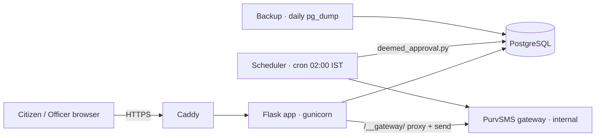

# Architecture

Citizen journey: `/apply` (mobile) → OTP SMS → `/verify` → `/form/1..3` → `/upload` → `/declaration` → confirmation + `/ack/<id>.pdf` → `/status` login → `/application/<id>`.
Officer journey: `/admin` → `/admin/dashboard` → `/admin/applications?status=` → `/admin/application/<id>` → approve/reject.
Nightly: applications `PENDING` beyond 15 days → `DEEMED_APPROVED` + SMS.
